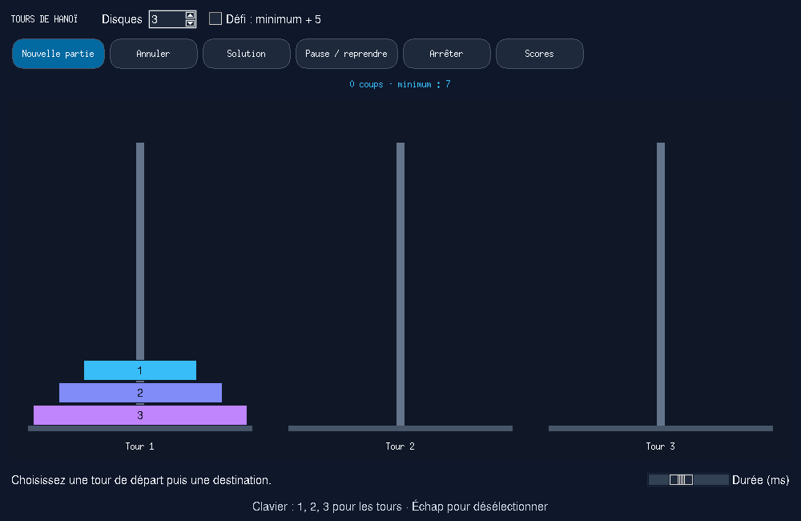

# Tours de Hanoï

[English documentation](README.en.md)

Un jeu de réflexion en Python avec une interface de bureau, un mode terminal et un solveur récursif animé. Issu d'un projet INF101 réalisé par **Mhamad Deaibess et Karim Hammoud**, il sépare désormais les règles, l'affichage et la persistance pour faciliter les tests et les évolutions.



## Fonctionnalités

- Trois tours et 1 à 10 disques, avec validation de chaque mouvement.
- Interface sombre, boutons avec états au survol et classement à lignes alternées.
- Contrôle à la souris ou au clavier, compteur et détection de victoire.
- Annulation successive des déplacements.
- Mode libre et mode défi : au maximum `2ⁿ − 1 + 5` coups.
- Solution récursive animée avec pause, reprise, arrêt et réglage de la durée.
- Démonstration indépendante : votre partie reste intacte.
- Scores persistants en JSON, plusieurs parties par joueur et classement complet.
- Mode terminal utilisable sans affichage graphique.

## Installation et lancement

Python **3.10 ou plus récent** est nécessaire. Le moteur utilise la bibliothèque standard ; l’interface graphique utilise Tkinter et **CustomTkinter** (boutons arrondis).

```bash
git clone https://github.com/MhamadDeaibess487/Tours-de-Hanoi-Hanoi-towers.git
cd Tours-de-Hanoi-Hanoi-towers
python -m venv .venv
# Linux/macOS
source .venv/bin/activate
# Windows PowerShell: .venv\Scripts\Activate.ps1
python -m pip install -e .
python -m hanoi
```

Selon votre système, la commande Python peut être `python3`. Sur Debian/Ubuntu, installez Tkinter si nécessaire avec `sudo apt install python3-tk python3-venv`. Les installations officielles de Python pour Windows incluent normalement Tcl/Tk ; sur macOS, utilisez une distribution proposant Tkinter.

Autres points d'entrée :

```bash
python -m hanoi --cli
python Projet-Hanoi.py
```

Aucun compte, service externe ou clé API n'est nécessaire.

## Jouer

Déplacez tous les disques de la tour 1 vers la tour 3. Un déplacement porte sur un seul disque, et un grand disque ne peut jamais être posé sur un plus petit.

Dans l'interface graphique, choisissez le nombre de disques et le mode, puis cliquez sur **Nouvelle partie**. Cliquez sur une tour source puis une destination, ou utilisez les touches **1**, **2**, **3**. **Échap** désélectionne la tour. Les boutons permettent d'annuler, consulter les scores ou lancer une démonstration depuis le plateau initial. Après la démonstration, **Arrêter** restaure l'affichage de votre partie. Le réglage de durée (en millisecondes) contrôle chaque déplacement : montée, glissement, puis descente. Les mouvements manuels sont également animés. Les clics supplémentaires sont ignorés pendant un déplacement ; annuler ou commencer une nouvelle partie interrompt l’animation proprement.

Dans le terminal, saisissez par exemple `1 3`. Les commandes sont `annuler`, `solution`, `scores`, `nouvelle` et `quitter`. La solution y est affichée sous forme de déplacements. Une victoire propose l'enregistrement du score et une nouvelle partie.

Le compteur représente les déplacements encore présents dans l'historique : annuler retire un coup. En mode défi, une limite atteinte autorise encore l'annulation ou le redémarrage. Les démonstrations n'enregistrent aucun score.

## Architecture

| Module | Responsabilité |
| --- | --- |
| `hanoi/game.py` | État de partie, règles, victoire, compteur et annulation |
| `hanoi/solver.py` | Générateur récursif de déplacements |
| `hanoi/scores.py` | Validation, sauvegarde atomique et classement JSON |
| `hanoi/ui.py` | Interface Tkinter, Canvas redimensionnable et événements |
| `hanoi/cli.py` | Interactions dans le terminal |
| `hanoi/__main__.py` | Sélection du mode et lancement |
| `tests/` | Tests du moteur, solveur, scores, terminal et interface |

Le solveur déplace récursivement `n − 1` disques sur la tour auxiliaire, déplace le plus grand disque, puis replace les `n − 1` disques sur la destination. Il produit exactement **`2ⁿ − 1` mouvements**, avec un temps en **O(2ⁿ)** et une mémoire auxiliaire en **O(n)** grâce au générateur. La limite de dix disques borne la durée de démonstration et garde le dessin lisible.

## Développement et tests

```bash
python -m venv .venv
# Linux/macOS
source .venv/bin/activate
# Windows PowerShell : .venv\Scripts\Activate.ps1
python -m pip install -e ".[dev]"
python -m pytest -q
ruff check .
ruff format --check .
```

Le test graphique est ignoré si `DISPLAY` est absent. Pour l'exécuter sous Linux sans écran :

```bash
sudo apt install xvfb
xvfb-run -a python -m pytest -q
```

GitHub Actions exécute les tests, le contrôle Ruff et le formatage pour Python 3.10, 3.12 et 3.13, avec affichage virtuel. Les tests vérifient notamment les solutions minimales pour 1 à 10 disques, les annulations, les mouvements invalides, la limite exacte du défi, la conservation des fichiers corrompus et un parcours graphique.

## Scores et dépannage

Les scores sont stockés dans `hanoi/scores.json` sous le répertoire de données utilisateur :

- Linux : `$XDG_DATA_HOME`, ou `~/.local/share`.
- macOS : `~/Library/Application Support`.
- Windows : `%LOCALAPPDATA%`, ou `~/AppData/Local`.

Les dates sont enregistrées en UTC. Le classement regroupe les parties par nombre de disques, puis trie les coups et la date. Un fichier invalide est signalé et conservé : sauvegardez-le avant toute réparation. L'écriture utilise un fichier temporaire puis un remplacement atomique ; l'accès simultané par plusieurs instances n'est pas pris en charge.

Si l'affichage graphique est indisponible, utilisez `--cli`. Les erreurs de saisie ou de mouvement sont signalées sans modifier le plateau. Fermer la fenêtre arrête aussi l'animation.

## Origine et compétences illustrées

Projet initial : INF101, **Mhamad Deaibess et Karim Hammoud**. La modernisation conserve le jeu manuel, l'annulation, les scores, le solveur et sa visualisation ; Turtle est remplacé par un Canvas Tkinter, et le lanceur historique reste utilisable.

Ce projet illustre la récursivité, les invariants d'un modèle, la séparation des responsabilités, une interface événementielle, la persistance et les tests automatisés. Aucune licence de redistribution n'a été choisie ; ce choix devra être validé avec les auteurs.
